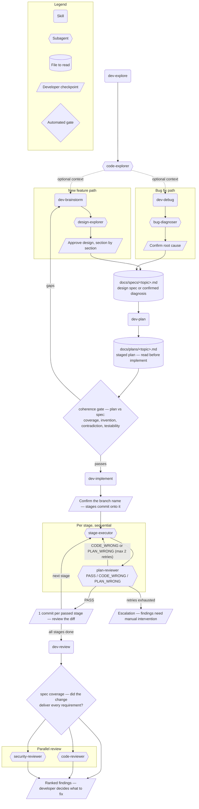

# Agnostic Agentic Dev Kit

A self-contained, stack-agnostic set of Claude Code **skills** and
**subagents** for general-purpose development. Provides a full `dev-brainstorm
→ dev-plan → dev-implement → dev-review` loop (with `dev-explore` feeding
brainstorm and plan) that works in **any** repository, in any language, without
depending on the superpowers plugin. `dev-debug` is an alternative entry point
for the same loop: instead of turning an idea into a design spec, it turns a
reported error into a confirmed root-cause diagnosis, written as a spec in the
same shape — so it converges on the same `dev-plan → dev-implement →
dev-review` stages as `dev-brainstorm` does.
Every worker discovers the project's own conventions and test/lint/build
commands at runtime — nothing is hard-coded to a stack.

## Components

### Skills (workflows you invoke)

| Skill | Role |
|-------|------|
| `dev-brainstorm` | Interactive: turn an idea into an approved design spec. Explore context → clarify one question at a time → weigh approaches → present design for approval → write spec to the working repo's `docs/specs/`. |
| `dev-debug` | Interactive: turn a reported error/log into a confirmed root-cause diagnosis. Collect the error → explore context → classify → dispatch `bug-diagnoser` → present diagnosis for confirmation → write it as a spec, same location as `dev-brainstorm`. Alternative entry point for bugs instead of new features. |
| `dev-explore` | Map/research unfamiliar code — trace flows, answer where/how. Read-only; fans out `code-explorer` subagents. |
| `dev-plan` | Turn a spec/intent into a staged, testable plan in the working repo's `docs/plans/`. Each stage names the spec requirement IDs it satisfies, and the plan is checked against its spec before handoff. |
| `dev-implement` | Orchestrate a staged plan: branch first, then one `stage-executor` per stage, each judged by `plan-reviewer`, bounded fix-or-redispatch loop. TDD is enforced by outcome — the executor reports the failure output captured before the implementation existed, and `plan-reviewer` rejects a stage without it. |
| `dev-review` | Verify (run the project's test/lint/build), check the change set against its spec's requirements, then dispatch `code-reviewer` + `security-reviewer` on the diff and collate ranked findings. |

### Subagents (cold workers, dispatched via the Agent tool)

| Subagent | Role |
|----------|------|
| `design-explorer` | Returns 2–3 solution approaches with trade-offs + a recommendation. |
| `bug-diagnoser` | Traces a reported error to its root cause with an evidence chain, not just where it surfaced. |
| `code-explorer` | Read-only research worker; returns findings, not file dumps. |
| `stage-executor` | Builds one plan stage, tests-first, minimal diff. |
| `plan-reviewer` | Judges a stage's diff vs the plan → `PASS` / `CODE_WRONG` / `PLAN_WRONG`. |
| `code-reviewer` | Correctness + over-engineering + quality findings on a diff. |
| `security-reviewer` | Trust-boundary / secrets / injection audit on a diff. |

## Workflow

Two entry points converge on the same build loop. `dev-brainstorm` starts from
an idea, `dev-debug` starts from a reported error — both end by writing a
spec-shaped file, and everything downstream (`dev-plan → dev-implement →
dev-review`) doesn't care which one produced it.



### Output files a developer must read or supervise

| Artifact | Written by | Why it matters |
|----------|-----------|-----------------|
| `docs/specs/<topic>.md` | `dev-brainstorm` (design) or `dev-debug` (confirmed diagnosis) | `dev-plan` treats this as ground truth — a wrong or unapproved spec produces a plan for the wrong thing. Both skills gate on your approval/confirmation before writing it. |
| `docs/plans/<topic>.md` | `dev-plan` | The stage-by-stage contract `stage-executor` and `plan-reviewer` build and judge against. Read it before `dev-implement` runs — everything after this point is largely automated. Its stage markers also record progress: `(IMPLEMENTED — awaiting review)` is code no reviewer has judged yet, `(DONE — date)` passed review and was committed. |
| One commit per passed stage | `dev-implement` (after `plan-reviewer` returns `PASS`) | The actual reviewable diff — `dev-implement` relays pass/retry/escalation status, but the commit itself is what to read. |
| Escalation report (in-conversation, not a file) | `dev-implement`, after 2 failed retries on one stage | The bounded fix-or-redispatch loop gave up — this needs your judgment call, not another automatic retry. |
| Ranked findings (in-conversation, not a file) | `dev-review` (`code-reviewer` + `security-reviewer`, collated) | Read-only — nothing is auto-fixed. You decide which findings to act on. |

## Examples

### New feature, full loop

> "I want to add per-user rate limiting to the public API."

`dev-brainstorm` explores the API code, asks clarifying questions one at a
time, dispatches `design-explorer` for approaches, and presents the design in
sections. Once you approve it, it writes `docs/specs/rate-limiting.md` and
hands off to `dev-plan`, which writes `docs/plans/rate-limiting.md`. Say "go
ahead and implement it" to run `dev-implement`, which builds and commits stage
by stage, then `dev-review` to get ranked findings before you merge.

**Supervise:** the design sections in `dev-brainstorm`,
`docs/plans/rate-limiting.md` before `dev-implement` starts, each stage's
commit, and the final findings.

### Bug fix from an error log

> "This is failing — [paste stack trace]. Can you debug it?"

`dev-debug` reads the trace, asks for anything missing to reproduce it, classifies
the affected subsystem, and dispatches `bug-diagnoser` to trace the failure
back to its root cause. It presents the root cause with its evidence chain and
a confidence level (`confirmed` vs `hypothesis`) — **you must confirm it**
before it writes `docs/specs/fix-<topic>.md`. From there the flow is identical
to the feature path: `dev-plan → dev-implement → dev-review`.

**Supervise:** the confirmed root cause (the hard gate — a wrong diagnosis
plans a fix for the wrong thing), then the plan/commits/findings as above.

### Research only, no build

> "How does this repo validate JWTs on incoming requests?"

`dev-explore` fans out one or more `code-explorer` subagents and returns a
synthesized answer with `file:line` references — nothing is written or
changed. Good for orienting before deciding whether a change is even needed.

**Supervise:** nothing — it's read-only; just read the answer.

### Resume from an existing spec or plan

> "Turn `docs/specs/rate-limiting.md` into a staged plan and implement it."

Skips `dev-brainstorm`/`dev-debug` entirely when a spec already exists
(hand-written, or left over from an earlier session) — go straight to
`dev-plan`, then `dev-implement`, then `dev-review`.

**Supervise:** same as the full loop, minus the design/diagnosis approval step
since that already happened.

## Install

The units live by type under the repo's `skills/` and `agents/`; this idea's
installer knows which ones it owns via `scripts/agnostic-agentic-dev-kit/units.txt`
and links (or copies) just those into `~/.claude/`.

- **Windows:** `pwsh -File scripts/agnostic-agentic-dev-kit/install.ps1`
  (needs Developer Mode or admin for live symlinks; otherwise it copies).
- **macOS/Linux:** `bash scripts/agnostic-agentic-dev-kit/install.sh`

After installing, invoke the skills by name — every one is prefixed `dev-` so
it is unmistakable against Claude Code's own commands: `dev-brainstorm`,
`dev-debug`, `dev-explore`, `dev-plan`, `dev-implement`, `dev-review`. The
subagents are not prefixed and are dispatched automatically by the skills,
never typed.

## Use from other CLIs

`scripts/agnostic-agentic-dev-kit/adapt.py` adapts this idea's units for
agentic CLIs other than Claude Code:

```
python scripts/agnostic-agentic-dev-kit/adapt.py codex [--dry-run]
```

- **Kimi CLI** needs nothing extra for skills — it already reads
  `~/.claude/skills`, so `install.ps1`/`install.sh` above covers it.
- **Skills are symlinked when the OS permits, and only then track source
  edits** — in copy mode (see below) re-run `adapt.py` after editing a skill,
  exactly like agents.
  **Agents are generated TOML — re-run `adapt.py` after editing any
  `agents/*.md`** for the change to reach `~/.codex/agents`.
- On Windows without Developer Mode (or admin), symlink creation is denied;
  `adapt.py` falls back to copying skills and says so in its output and final
  report — don't assume a symlink happened.
- Agent memory is repointed at the target's own directory: `.claude/agent-memory/`
  becomes `.codex/agent-memory/` for Codex, or `.agents/memory/` for a target
  with no convention of its own. Memory needs no platform feature — the agent
  just reads and writes the directory with its file tools — so the path only has
  to be consistent. `adapt.py` **fails loud** if the source wording changes
  enough that the rewrite stops matching, rather than shipping an agent pointed
  at a directory the target never provisions.
- The Codex skills path (`~/.agents/skills`) is per official OpenAI docs; it
  has **not** been verified against an installed `codex` on this machine. If
  Codex doesn't pick up skills there, check your installed version's actual
  skills directory and adjust the `TARGETS` entry in `adapt.py`.
- opencode and Kimi **agent** emitters are not implemented — opencode's skills
  directory and Kimi's agent format are unverified, so `adapt.py` only
  supports `codex` today.

## Validate

`bash scripts/agnostic-agentic-dev-kit/validate.sh`
(or `pwsh -File scripts/agnostic-agentic-dev-kit/validate.ps1`) checks every unit
in `units.txt` for complete frontmatter and the absence of stack-specific
references.

## Constitution

Non-negotiables — test/lint/build commands and rules the loop must never
violate — live in a `## Constitution` section of the *working* repo's own
`CLAUDE.md` or `AGENTS.md` (not this repo's; this repo's `CLAUDE.md` is
gitignored). It's already read by every worker that opens that file: `dev-plan`,
`stage-executor`, `plan-reviewer`, and `dev-review` all start by reading
`CLAUDE.md` / `AGENTS.md` for conventions before doing anything else — a
`## Constitution` section is just content within the file they already read,
not a new mechanism.

**Framing rule: state outcomes, not process.** Write "a stage fails if its
tests pass against a stubbed implementation" or "acceptance checks must be
executable," not "the agent must write the test first." An outcome is
something a reviewer can check against the diff and the test transcript; a
process instruction only produces the agent's own narration of having
followed it, which isn't verifiable. See
`docs/test-driven-agentic-development.md` for why — process prescriptions in
the constitution were considered and rejected for this exact reason.

## Background reading

Neither is required to use the kit; both explain why it is shaped this way.

- `docs/spec-driven-development-guide.md` — spec-driven development: the
  methodology `dev-brainstorm` → `dev-plan` → `dev-implement` follows, and the
  Spec Kit pipeline the skills map onto.
- `docs/test-driven-agentic-development.md` — what the evidence actually
  supports about TDD inside an agent loop, and which of its mechanisms this
  kit adopts, rejects, or cannot apply to itself.

## Notes for consumers

- `dev-plan` writes to the **working** repo's `docs/plans/`, `dev-brainstorm`
  and `dev-debug` both to its `docs/specs/` (a confirmed diagnosis is written
  in the same shape as a design spec, so `dev-plan` needs no special-casing to
  consume it). The kit never edits a target repo's `.gitignore` — add
  `docs/plans/` and `docs/specs/` there yourself if you want them uncommitted.
- Agent memory is **per-project**: subagents write to the working repo's
  `.claude/agent-memory/<agent>/` (via `memory: project`), shared through that
  repo's git.
- If installed in copy mode (no symlink permission), re-run the installer after
  editing any source skill/agent so the change reaches `~/.claude/`.
