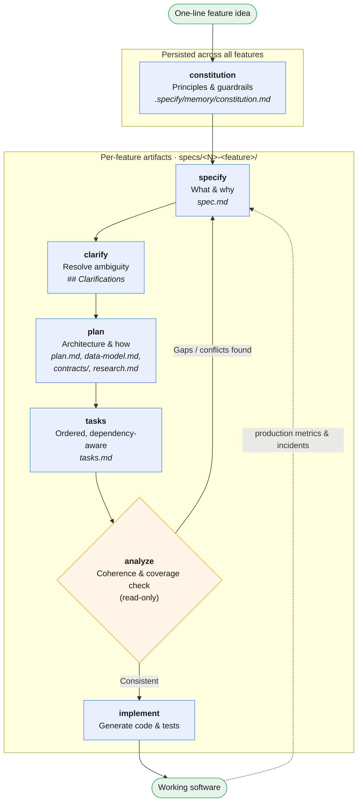

# Spec-Driven Development (SDD): A Practical Guide

## Introduction

For decades, code was the source of truth. Specifications—PRDs, design docs, diagrams—were scaffolding: written to guide development, then discarded once the "real work" of coding began. They were always subordinate to the code, and as the code moved forward, the specs rarely kept pace.

**Spec-Driven Development (SDD) inverts that relationship.** The specification becomes the primary, authoritative artifact, and code becomes its generated expression in a particular language and framework. Formally, SDD is a software engineering methodology where a formal, machine-readable specification serves as the authoritative source of truth and the main artifact from which implementation, tests, and documentation are derived. It requires that the system's intent be defined explicitly, in a structured document, *before* implementation begins.

SDD is not a prescriptive framework like Scrum. It is an approach built on three simple commitments:

1. Write a clear specification of what you want to build first—objectives, business rules, acceptance criteria, technical constraints.
2. Use that specification as the source of truth for both humans *and* AI agents.
3. Generate code from the spec, not from improvised prompts.

### Why now: the vibe-coding problem

The idea of "specify before you code" is as old as software engineering, but SDD has resurged for a specific reason: **large language models need structured context to generate coherent code.**

In February 2025, Andrej Karpathy coined *vibe coding*—letting an AI build software while you "forget the code even exists," accepting every diff and pasting errors back without reading them. It works for weekend projects and prototypes, but it breaks down at scale: subtle bugs, inconsistent architectures, security vulnerabilities, and code that neither you nor the AI fully understands. When you give an agent a vague prompt like "build me a login," it guesses the architecture, patterns, validations, and error flows. Ask it to "create a login function" and it will—but will it use OAuth 2.0? How will it handle sessions? Will it match your existing database schema? Without an explicit spec, the AI just fills in whatever seems "appropriate."

Three trends make SDD not just possible but necessary:

- **AI has crossed a capability threshold** where natural-language specs can reliably generate working code, automating the mechanical translation from intent to implementation.
- **Software complexity keeps growing**, making manual alignment between intent and dozens of services, frameworks, and dependencies increasingly hard.
- **The pace of change has accelerated**; pivots are now expected, and SDD turns requirement changes from disruptions into systematic regenerations.

A spec functions as a persistent, versionable "super-prompt." Because AI conversations reset context each session—the next session doesn't know you decided to use JWT last time—a durable spec is what prevents architectural drift across sessions and across multiple collaborating agents.

### The three levels of SDD

Birgitta Böckeler (Thoughtworks) offers a useful taxonomy of how deeply teams adopt SDD:

- **Spec-first**: You write the spec before coding, use it for the current task, then discard it. The most basic level.
- **Spec-anchored**: The spec is kept after the task completes and is used for the feature's evolution and maintenance.
- **Spec-as-source**: The spec is *the* primary artifact. You only edit the spec, never the code directly; code is regenerated from the specification.

Most tools today operate at spec-first, some aim for spec-anchored, and only a few experiment with spec-as-source.

---

## Core Principles

SDD rests on a handful of principles that distinguish it from both traditional documentation and from ad-hoc AI prompting:

- **Specifications as the lingua franca.** The spec is the primary artifact; code is its expression. Maintaining software means evolving specifications.
- **Executable specifications.** Specs must be precise, complete, and unambiguous enough to generate working systems—eliminating the gap between intent and implementation.
- **Continuous refinement.** Consistency validation is ongoing, not a one-time gate. AI analyzes specs for ambiguity, contradictions, and gaps throughout.
- **Research-driven context.** Research agents gather technical context—library compatibility, performance benchmarks, security implications, organizational constraints—and fold it into the spec.
- **Bidirectional feedback.** Production reality (metrics, incidents, operational learnings) feeds back into specification evolution.
- **Living, not waterfall.** SDD does *not* mean exhaustive upfront documents nobody reads. Specs are living, executable, versioned artifacts that evolve with the code, and the methodology works best at the feature or sprint level—not by specifying an entire product in advance.

A critical corollary: **spec quality equals output quality.** The rigor of your specification directly determines the quality of what the AI produces. Garbage in, garbage out.

---

## The SDD Workflow in Practice

The most mature practical implementation today is **GitHub Spec Kit**, an open-source toolkit (created with Microsoft) that provides a repeatable command pipeline. It doesn't replace your coding agent—it gives the agent a structured workflow and works with 30+ agents including Claude Code, GitHub Copilot, Cursor, and Gemini CLI. Each command produces a markdown artifact that feeds the next, so the agent always has structured context.

The commands follow a **strict left-to-right dependency order**: you cannot plan before you specify, and you cannot implement before you have tasks.

### Pipeline overview



The two feedback arrows are what make SDD *living* rather than waterfall: `analyze` loops back to the spec when it finds gaps or conflicts, and production reality (metrics, incidents) feeds the next round of specification. A companion `checklist` command can be run alongside `specify`/`clarify` to validate requirements completeness—like "unit tests for English."

### The pipeline

**1. `constitution` — Define your non-negotiables.**
Establishes the project's foundational principles, standards, and guardrails. Written once and persisted (in `.specify/memory/constitution.md`), it governs every subsequent step. Even for small projects, defining principles up front catches violations early and keeps AI output consistent. Typical articles cover things like library-first design, test-first discipline, simplicity limits, and integration-first testing.

**2. `specify` — Capture the "what" and "why."**
Transforms a one-line feature description into a structured `spec.md`: user stories, functional requirements, acceptance criteria, scope boundaries. It auto-numbers the feature, creates a semantic Git branch, and sets up the `specs/<N>-<feature-name>/` directory. Crucially, the template forces the spec to stay at the level of *what users need and why*—no tech stack, no APIs, no code structure—and mandates `[NEEDS CLARIFICATION]` markers wherever the prompt is ambiguous, so the AI flags unknowns instead of silently guessing.

**3. `clarify` — Resolve ambiguity.**
Runs a structured ambiguity scan across categories like functional scope, domain model, UX flow, non-functional attributes, integration, and edge cases. It asks up to five targeted questions, one at a time, and writes each answer back into the spec under a `## Clarifications` section. Resolving unknowns here is far cheaper than discovering them halfway through implementation. You can run it multiple times.

**4. `plan` — Translate intent into architecture.**
Generates `plan.md`, the "how": language and framework, data model, external services, architecture. Because the plan is grounded in both the spec and the constitution, it stays consistent with your principles rather than drifting toward whatever the model would pick by default. It also produces supporting documents (`data-model.md`, `contracts/`, `research.md`, `quickstart.md`).

**5. `tasks` — Break work into executable units.**
Converts the plan and its design documents into an ordered, dependency-aware `tasks.md`. Independent tasks are marked `[P]` for safe parallelization.

**6. `analyze` — Check coherence (before implementing).**
A read-only cross-artifact analysis that checks `spec.md`, `plan.md`, and `tasks.md` for duplications, ambiguities, underspecification, constitution violations, and coverage gaps. It's your last line of defense against a requirements mismatch. Always run it before implementation; then ask the agent to apply fixes.

**7. `implement` — Generate the code.**
The agent works through the task list and writes the code, grounded in every prior artifact.

A companion `checklist` command can generate custom quality checklists that act like "unit tests for English," validating requirements completeness, clarity, and consistency.

### The payoff of structured automation

What might take ~12 hours of traditional documentation work (PRD, design docs, project setup, technical specs, test plans) compresses into roughly 15 minutes of focused specification work. But the real value isn't just speed—it's that the templates enforce discipline:

- **No forgotten details**: templates ensure every aspect is considered.
- **Traceable decisions**: every technical choice links back to a specific requirement.
- **Living documentation**: specs stay in sync with code because they generate it.
- **Rapid iteration**: change a requirement, regenerate the plan in minutes.

### A realistic mindset: hybrid, not sacred

SDD is not magic, and treating the spec as immutable is the most common mistake. In practice you *will* need to intervene: the AI will make mistakes, you'll realize you missed something, requirements will change. The winning approach is a **hybrid mindset**—the spec provides order and a contract, but you stay in control and can tell the agent "stop, do this differently."

Be aware of the real trade-offs:

- **Documentation time.** Time spent writing specs is time not spent coding. It pays off as feature complexity grows, but for tiny bug fixes the ceremony is disproportionate—like using a sledgehammer to crack a nut.
- **Maintaining code *and* docs.** Keeping both in sync is real overhead. (The mitigation: at spec-anchored/spec-as-source levels, the spec *is* the maintained artifact; and increasingly, agents can re-derive implicit context by reading the existing code.)
- **A false sense of control.** Larger context windows don't guarantee the AI follows every instruction—it may under- or over-comply. Specs reduce but don't eliminate LLM non-determinism. You still review and validate.
- **Reviewing markdown vs. code.** Some tools generate large volumes of repetitive markdown. A good SDD tool should make spec review genuinely better than code review, not worse.

**SDD is worth it if** you regularly work with AI coding agents, your projects are medium-to-high complexity, and you value traceability and living documentation. **You probably don't need it** for quick prototypes, personal projects, or work that's mostly small fixes and maintenance.

To adopt it, start small: pick one well-understood feature where alignment problems are visible, write a lightweight spec, generate the implementation, and review the output against the spec. Don't specify your whole application at once.

---

## Extending SDD with TDD (and BDD)

SDD, TDD, and BDD are close relatives, not competitors. Each was born to solve a specific problem of its era, and they operate at different levels of abstraction, so they combine cleanly. Before showing how to layer them, it's worth defining each precisely.

### Test-Driven Development (TDD)

**Definition.** TDD is a development practice, popularized by Kent Beck in the early 2000s, where you write an automated test *before* writing the production code. It inverts the traditional "code first, test later" order and follows a short, repetitive cycle called **Red-Green-Refactor**:

1. **Red** — Write a test that fails, because the code it exercises doesn't exist yet.
2. **Green** — Write the minimum code necessary to make the test pass.
3. **Refactor** — Improve the code's structure while keeping all tests green.

```typescript
// 1. RED — write the test first; validateEmail doesn't exist yet
describe('validateEmail', () => {
  it('returns true for a valid email', () => {
    expect(validateEmail('user@domain.com')).toBe(true);
  });
  it('returns false when @ is missing', () => {
    expect(validateEmail('userdomain.com')).toBe(false);
  });
});

// 2. GREEN — minimum code to pass
function validateEmail(email: string): boolean {
  return /^[^\s@]+@[^\s@]+\.[^\s@]+$/.test(email);
}

// 3. REFACTOR — improve without breaking the green bar
```

**What it's good for.** TDD guarantees test coverage, produces an *emergent design* (writing the test first forces you to design the interface before the implementation), gives you living documentation of what the code does, and makes refactoring safe. Its main costs are a real learning curve, a slower-feeling start, a purely technical vocabulary (tests speak the developer's language, not the business's), and difficulty retrofitting onto untested legacy code. TDD operates at the **unit / code-correctness** level: *is the code correct?*

### Behavior-Driven Development (BDD)

**Definition.** BDD was created by Dan North to fix a gap he saw in teams practicing TDD: the tests were written in technical language only developers understood, leaving the business out of the conversation. BDD shifts the focus from unit tests toward the *expected behavior of the system*, described in a structured natural language—typically the **Given / When / Then** format, commonly written in **Gherkin**, which both developers and business people can read.

```gherkin
Feature: User email validation
  As a registration system
  I want to validate user emails
  So that I can be sure I can contact them

  Scenario: Email without an "@"
    Given a user enters the email "userdomain.com"
    When the system validates the email
    Then validation must fail
    And the error message must be "Email must contain @"
```

These human-readable scenarios connect to code through **step definitions** that map each `Given`/`When`/`Then` line to executable assertions.

**What it's good for.** BDD gives business and development a *common language*, turns scenarios into *executable documentation*, keeps the focus on business value (what the system should do, not how), and lets product owners write and review scenarios. Its costs are a significant setup overhead, the ongoing maintenance of step definitions, a temptation toward over-engineering (not everything needs a Gherkin scenario), and a dependency on team discipline—if the business doesn't participate, BDD loses most of its value. BDD operates at the **system-behavior** level: *does the system behave as expected?*

### How the three relate

Each is the opposite of a different problem: TDD opposes untested code, BDD opposes ambiguous requirements, and SDD opposes vibe coding. They stack naturally by scope:

| Aspect | TDD | BDD | SDD |
|---|---|---|---|
| **Primary artifact** | Unit tests | Gherkin scenarios | Specification document |
| **Language** | Test code | Gherkin (structured natural language) | Structured Markdown/text |
| **Audience** | Developers | Whole team + business | Developers + AI |
| **The opposite of…** | Untested code | Ambiguous requirements | Vibe coding |
| **Cycle** | Red-Green-Refactor | Discovery-Formulation-Automation | Spec-Generate-Intervene |
| **Answers** | Is the code correct? | Does the system behave right? | What and why are we building? |

In short: **SDD tells you *what* and *why*. BDD verifies behavior across the whole system. TDD ensures correctness at the code level.** The natural composition is: general specification (SDD) → business scenarios (BDD) → unit tests (TDD).

### Why the pairing matters

SDD captures complete product intent but doesn't, by itself, *prove* the generated code is correct. TDD does exactly that. And when an AI generates the implementation, you need an independent, executable check that it did what the spec asked—LLM output is non-deterministic, so "the agent said it's done" is not proof. TDD provides that objective, runnable verification layer.

This isn't a bolt-on. Spec Kit's own methodology bakes test-first thinking directly into the spec: acceptance scenarios in the specification become tests, and the constitution can make TDD non-negotiable. In Spec Kit's reference constitution, the **Test-First Imperative** states that no implementation code is written before (1) tests are written, (2) tests are reviewed and approved, and (3) tests are confirmed to *fail* (the Red phase). This inverts naive AI code generation: instead of generating code and hoping it works, the agent first generates comprehensive tests that define behavior, gets them approved, and only then generates implementation to make them pass.

### How to integrate TDD into the SDD pipeline

The cleanest integration point is between planning and implementation, enforced by the constitution and the task list:

1. **Encode test-first in the constitution.** Add an article requiring strict TDD, so every generated plan and task list respects it. This makes the discipline structural rather than optional.

2. **Derive test scenarios in the spec.** During `specify` and `clarify`, capture acceptance criteria as concrete, testable scenarios. Every requirement should be phrased so it can become a failing test. If it can't be tested, it isn't specified well enough.

3. **Order tasks test-first.** Have `tasks` produce test files before implementation files. A common ordering: define contracts first, then write tests (contract → integration → e2e → unit), then write the source that makes them pass. This forces the agent to think about testability and contracts before writing code.

4. **Run Red-Green-Refactor during `implement`.** The agent writes the failing test (Red), writes minimal code to pass it (Green), then refactors while keeping tests green. Because the tests derive from the spec, a passing suite is objective evidence that the generated code satisfies the specification.

5. **Feed failures back into the spec.** When a test surfaces a gap or contradiction, fix it in the spec (and clarifications), not just in the code. This keeps the spec as the source of truth and prevents drift.

A minimal illustration of the flow for a single unit, e.g. an email validator:

- **SDD** defines the contract in the spec: the `validateEmail(email: string): ValidationResult` interface, validation rules (exactly one `@`, non-empty local part, a dot in the domain, no spaces, max 254 chars per RFC 5321), edge cases (subdomains and `+` tags are valid; normalize to lowercase), error behavior, and explicit non-goals (no DNS lookup, no verification email).
- **TDD** then turns each rule and edge case into a failing test, and the agent writes the implementation to satisfy them.

The spec guarantees you're building the *right* thing; the tests guarantee you're building the thing *right*.

> **Note on BDD as a bridge.** If non-technical stakeholders must validate behavior, Gherkin `Given-When-Then` scenarios can live inside the spec itself. They're human- and machine-readable, serve as executable documentation, and give the AI a behavioral contract that maps naturally onto both SDD acceptance criteria and TDD test cases.

---

## Summary

SDD reorganizes development around the specification as the central source of truth, with implementation plans and code as continuously regenerated output. It exists because AI can now turn structured specs into working code, but only structured specs—vague prompts produce chaos. The practical loop is: define principles (constitution), capture intent (specify), resolve ambiguity (clarify), design (plan), decompose (tasks), verify coherence (analyze), and generate (implement)—kept honest by a hybrid mindset that treats the spec as a living contract rather than sacred scripture.

Layering TDD on top closes the quality loop: SDD ensures alignment between intent and implementation, and TDD provides the objective, executable proof that the AI-generated code actually meets that intent. Even applied informally, SDD's underlying discipline—*think before you generate, specify before you implement*—is a good engineering practice with or without AI.

---

## Sources

- GitHub Spec Kit — *Specification-Driven Development (SDD)*: https://github.com/github/spec-kit/blob/main/spec-driven.md
- GitHub — *spec-kit repository*: https://github.com/github/spec-kit
- Microsoft for Developers — *Spec-Driven Development: A Spec-First Approach to AI-Native Engineering*: https://developer.microsoft.com/blog/spec-driven-development-ai-native-engineering/
- Web Reactiva (Dani Primo) — *TDD vs BDD vs SDD: Guía completa de metodologías de desarrollo de software*: https://www.webreactiva.com/blog/tdd-vs-bdd-vs-sdd
- Wikipedia (ES) — *Desarrollo dirigido por especificaciones*: https://es.wikipedia.org/wiki/Desarrollo_dirigido_por_especificaciones
- Scrum Manager — *Spec Driven Development: qué es y qué propone*: https://scrummanager.com/community/spec-driven-development-qu-es-de-dnde-viene-y-por-qu-importa
- Birgitta Böckeler (Thoughtworks / Martin Fowler) — *Understanding Spec-Driven Development: Kiro, spec-kit, and Tessl*: https://martinfowler.com/articles/exploring-gen-ai/sdd-3-tools.html
- Shiplight AI — *GitHub Spec Kit Workflow: A Practical Guide*: https://www.shiplight.ai/blog/spec-driven-development-with-spec-kit
